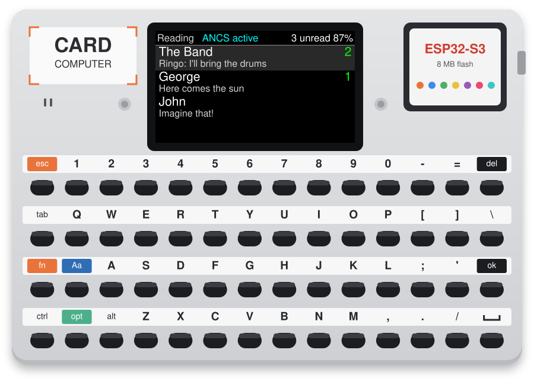
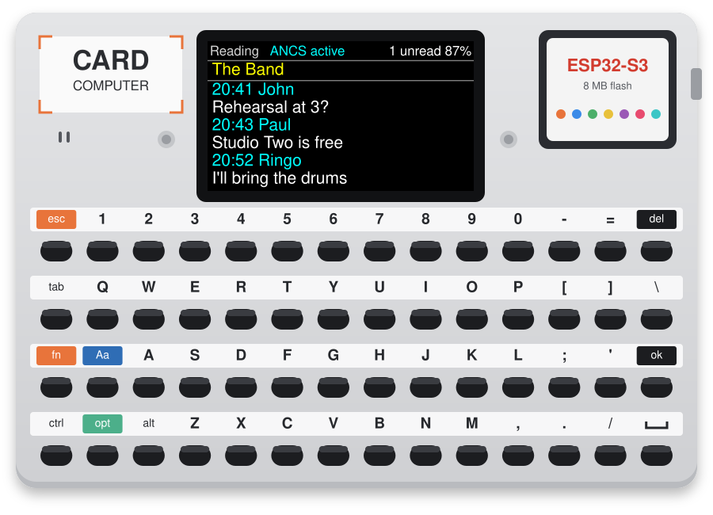
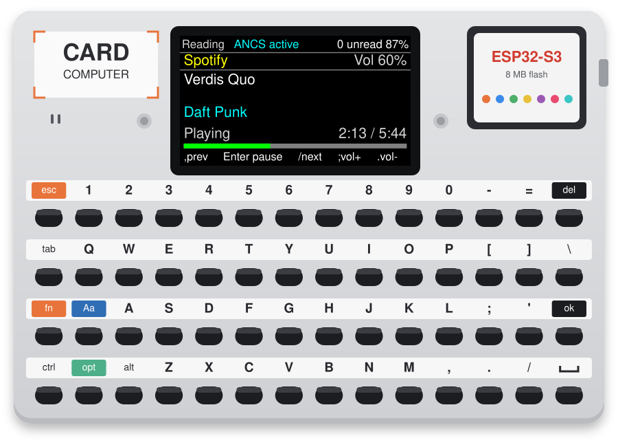
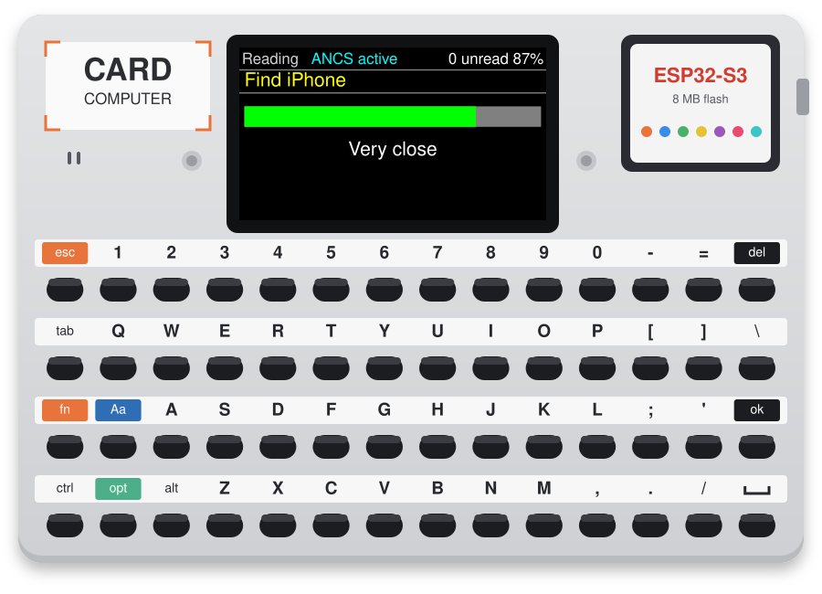
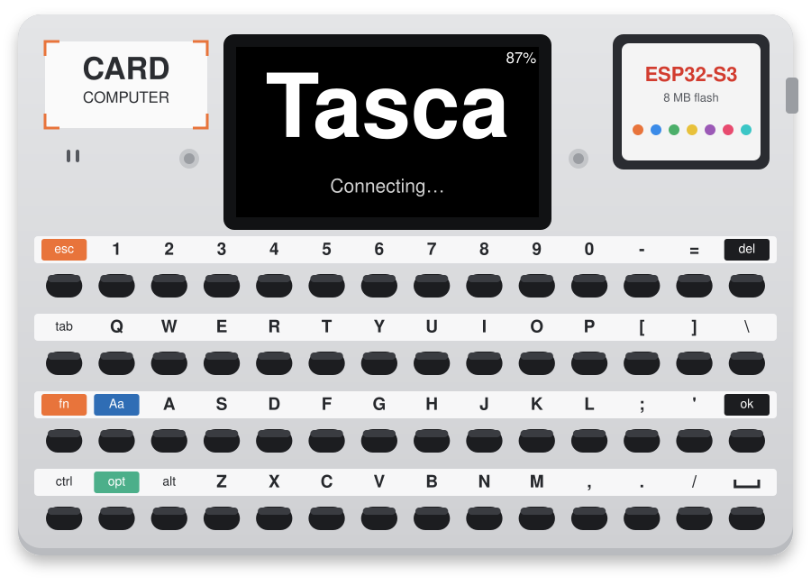

<p align="center">
  
</p>

<h1 align="center">Tasca</h1>

<p align="center"><strong>Keep your iPhone in your pocket.</strong><br>
WhatsApp notifications, music controls and Find iPhone on the M5Stack Cardputer, over Bluetooth.</p>

<p align="center"><a href="https://carlofanelli.github.io/tasca/"><strong>Install from the browser</strong></a> · <a href="https://github.com/CarloFanelli/tasca/releases/latest">Download</a> · <a href="#set-up-the-iphone">Set up the iPhone</a></p>

Tasca is firmware for the [M5Stack Cardputer v1.1](https://docs.m5stack.com/en/core/Cardputer_v1.1), the small ESP32-S3 computer with a keyboard. Paired with your iPhone, it shows your WhatsApp messages as they arrive, so you can read them without taking the phone out. Nothing to install on the iPhone: it uses the Bluetooth features iOS already offers to watches and accessories.

- **WhatsApp on a small screen**: chats with unread counts, the messages of each chat, a beep for each new one.
- **Clear from the Cardputer**: clearing a chat removes its notifications from the iPhone too.
- **Find iPhone**: a beep when you leave the iPhone behind, and a screen that tells you when you are getting closer to it.
- **Music controls**: what the iPhone is playing, play/pause, next, previous and volume.
- **A keyboard for the iPhone**: type on the iPhone with the Cardputer's keys, start Siri with one key.
- **Meshtastic chat**: with the LoRa unit, read and write on the Meshtastic public channel, even without the iPhone.

| Chat | Music | Find iPhone |
| --- | --- | --- |
|  |  |  |

## What you need

- An **M5Stack Cardputer v1.1**. Tasca is made and tested on it; other Cardputer models are untested.
- An **iPhone** with WhatsApp.
- Optional, for the Mesh chat: the **M5Stack LoRaWAN unit (EU868)** on the Grove port, and a **microSD card** to keep its history.
- A **USB-C data cable** and a computer with **Chrome** or **Edge** (Windows, macOS or Linux), only to install the firmware.

## Install

Installing replaces whatever runs on the Cardputer now. It takes about two minutes, from Chrome or Edge on a computer.

1. **Connect** the Cardputer to the computer with a USB-C data cable and switch it on.
2. **Open** the [install page](https://carlofanelli.github.io/tasca/) and click **Install Tasca**.
3. **Pick** the Cardputer in the list (it is usually called "USB JTAG/serial debug unit") and confirm.
4. **Wait** until the page says the installation is complete. The Cardputer restarts and shows "Tasca" and "Connect your iPhone".

If the Cardputer is not in the list, put it in download mode: unplug it, hold the **G0** button (on the side) while plugging the cable in, then try again. In download mode the screen stays dark; press reset once the install is done.

<details>
<summary>Install without the install page</summary>

Download `tasca-…-cardputer.bin` from the [latest release](https://github.com/CarloFanelli/tasca/releases/latest), then either:

- open the [ESP web flasher](https://espressif.github.io/esptool-js/) in Chrome or Edge, click **Connect**, pick the Cardputer, set **Flash Address** to `0x0`, choose the file and click **Program**; or
- from the command line: `pip install esptool`, then `esptool --chip esp32s3 write-flash 0x0 tasca-…-cardputer.bin`.

Press reset when it is done.
</details>

## Set up the iPhone

Do these steps in order. Menu names may differ slightly between iOS versions.

1. **Pair.** Settings > Bluetooth > select "Tasca". Pairing needs no PIN. A Cardputer that ran other firmware may show up under its old name (e.g. "ESP32") until the first connection.
2. **Share notifications.** Accept the request to share notifications. If it does not appear: Settings > Bluetooth > (i) next to "Tasca" > turn on "Share System Notifications", then restart the Cardputer.
3. **WhatsApp previews.** Settings > Notifications > WhatsApp: notifications allowed, previews "Always". In WhatsApp > Settings > Notifications: "Show Preview" on. Without previews the text does not arrive.
4. **Keyboard layout.** With "Tasca" connected: Settings > General > Keyboard > Hardware Keyboard, layout "Automatic" (or "U.S."). With another layout, keys type that layout's characters.
5. **Focus.** Chats filtered by a Focus or muted send no notifications: allow WhatsApp in the Focus modes you use.

Messages that arrive from now on appear on the Cardputer, together with the ones still in the iPhone's Notification Center.

## What it can and cannot see

Only what reaches the iPhone as a notification is visible: no chat history, no messages you sent, nothing from muted chats. Messages are kept in the Cardputer's memory only: after a restart it shows the notifications still on the iPhone. A message read or cleared on the iPhone disappears from the Cardputer too.

Messages on the Cardputer are readable by anyone holding it: there is no screen lock or PIN.

## Using the Cardputer

G0 (the button on the side) switches between **Reading mode**, where keys stay on the Cardputer, and **Keyboard mode**, where keys go to the iPhone. The status bar at the top shows the mode, the link state, the unread count and the battery.

### Reading mode

| Key | Action |
| --- | --- |
| `;` / `.` | Move up / down in the Inbox, scroll a Chat |
| Enter | Open the selected Chat |
| `` ` `` | Back to the Inbox, or out of Settings |
| Fn+G0 | Open the Menu: Music, Find iPhone, Mesh, WhatsApp, Settings |
| Opt+s | Open Settings |
| Del, twice | Clear the selected or open Chat on the iPhone too. Messages the iPhone keeps show "Not cleared on the iPhone" |
| Fn+Enter | Start Siri (see below) |
| Fn+Del, held 3 s | Reset pairing and restart |

**Menu**: Fn+G0 opens it over any screen, in either mode. `;` and `.` select an item, Enter opens it; `` ` `` or Fn+G0 again closes it. During a call Fn+G0 does nothing; without the iPhone it opens the Menu over the Connection screen, where only Mesh and Settings open.

**Settings**: `;` and `.` select a row, `,` and `/` change its value: brightness, sound, display timeout (15 s to 5 min, or Never), wake on new message, Find iPhone and Mesh sound. Enter on "Mesh name" edits it in place: Enter saves, `` ` `` cancels. "Reset pairing" and "Clear messages" run on Enter, then Enter again to confirm. "Clear messages" empties the Cardputer only: the notifications stay on the iPhone. Settings are kept across restarts.

The screen turns off after the display timeout; a key or G0 turns it back on. In Reading mode that key does nothing else; in Keyboard mode it is also sent to the iPhone. Each message arriving live beeps when sound is on, and turns the screen on when wake on new message is on.

### Keyboard mode

Every key goes to the iPhone, typing its keycap legend, wherever the cursor is: open the chat on the iPhone, tap the text field, then type on the Cardputer. Fn+a/e/i/o/u give à è ì ò ù, Ctrl+e gives é.

### Music

The Music screen (Menu > Music) shows what the iPhone is playing in any app (Spotify, Apple Music, podcasts): player, title, artist, play state, elapsed and total time, volume.

| Key | Action |
| --- | --- |
| Enter | Play / pause (Play when nothing is playing) |
| `,` / `/` | Previous / next track |
| `;` / `.` | Volume up / down; held, it keeps changing |
| `` ` `` | Back to the Inbox |

Keys the player does not offer right now (e.g. next on some podcasts) are dimmed and do nothing. Some apps, Spotify among them, may send the artist inside the title.

### Find iPhone

**Find iPhone screen**: with the iPhone connected (within about 10 m), Menu > Find iPhone shows how near it is from the Bluetooth signal: a bar, Very close (up to about 1 m), Near (about 2 m) or Far (3 m and beyond), and a beep that gets faster as you get closer, even with sound off. The iPhone does not ring; the signal is strongest near its top edge. Beeps stop after 5 minutes without a key; `` ` `` goes back to the Inbox. Opening it turns Find iPhone on in Settings.

**Out-of-range alert**: with Find iPhone on in Settings (the default), when the iPhone is lost by distance (not when you switch its Bluetooth off or power it off), the Cardputer turns the screen on, shows "iPhone out of range" and plays a triple beep every 5 s, even with sound off. A key or G0 silences it; it stops by itself after 2 minutes, and ends when the iPhone is back.

### Mesh

With the M5Stack LoRaWAN unit (EU868, RAK3172) on the Grove port, the Cardputer joins the [Meshtastic](https://meshtastic.org) public channel used in Italy (EU_868, MediumFast, 869.525 MHz): it reads the channel's text messages and sends its own, with or without the iPhone. The unit is found within a few seconds of startup or of plugging it in.

Menu > Mesh opens the **Mesh screen**: the messages, newest at the bottom, each with its time, the sender's short name and the text. The Menu shows the unread count beside "Mesh".

| Key | Action |
| --- | --- |
| `;` / `.` | Scroll |
| Enter | Write a message (only with the LoRa unit plugged in) |
| Tab | Node list: the nodes heard, newest first, with signal strength and time since last heard |
| Del, twice | Clear every Mesh message, on screen and on the microSD card |
| `` ` `` | Back |

**Writing**: Enter opens a line at the bottom; keys type as in Keyboard mode (Fn+a/e/i/o/u give à è ì ò ù, Ctrl+e gives é), and the number on the right is the bytes left out of 200 (an accented letter takes 2). Enter sends, `` ` `` closes without sending. Your message then reads "sent", "heard" once a nearby node repeats it, or "not heard" after 30 s. The radio may be on air at most 10% of an hour: past that, Enter shows "Radio limit: wait".

**Mesh name**: Settings > "Mesh name" is how the other nodes see you; its first 4 characters are the short name shown beside your messages. Without one it is "Tasca" and 4 digits of the Cardputer's node ID. The Cardputer announces it when the LoRa unit is found, when you change it and every 3 hours. Settings > "Mesh sound" beeps for each Mesh message, even with sound off.

**Time**: while the iPhone is connected the Cardputer takes its time of day and keeps it until restart: messages show the time they arrived. Before that they show how long ago ("5m"), and after a restart "--:--" when their time was not known.

**History**: the last 500 messages and the nodes heard are kept on the microSD card, in `Tasca/Mesh/`, and come back after a restart. Without a card, or when it is full, "not saved" appears beside the title and the history lasts until restart. **The history on the card is plain text: anyone holding the card can read it.**

The public channel is public: anyone nearby with Meshtastic reads what you send. Direct messages, private channels and relaying other nodes' messages are not supported.

### Siri

Fn+Enter starts Siri on the iPhone, from either mode, locked or unlocked. Hold it while you start speaking, as a headset button. You speak through the iPhone's or the earphones' microphone: the Cardputer has no Bluetooth audio.

- `` ` `` right after Fn+Enter closes Siri (it sends Esc; if Siri already closed, Esc reaches the app, e.g. WhatsApp goes back to the chat list).
- Replies by voice work: "Reply to Mario on WhatsApp …". On a locked iPhone, Siri asks to unlock before sending: press G0 for Keyboard mode, type the passcode on the Cardputer, Enter.
- iPhone settings: Settings > Siri: "Press Side Button for Siri" or "Listen for" on, and "Allow Siri When Locked" on. Keep "Type to Siri" off: it replaces voice Siri.

## Connection screen



While the iPhone is not connected, at startup and whenever it disconnects, the Cardputer shows "Tasca" in large type, the battery, and one line:

| Line | Meaning |
| --- | --- |
| Connecting… | An iPhone is paired: the Cardputer waits for it to come back in range with Bluetooth on. |
| Connect your iPhone | No iPhone is paired: pair one (see [Set up the iPhone](#set-up-the-iphone)). |
| Forget Tasca on the iPhone | Pairing failed because the iPhone remembers an old pairing: forget "Tasca" there, then pair again. |
| iPhone out of range | The iPhone was lost by distance, with Find iPhone on. |

Keys and G0 do nothing else on this screen, except Fn+Del held 3 s and Fn+G0, which opens the Menu. When the iPhone connects, the screen you were on comes back. The Mesh screen is not covered when the iPhone is lost: the Connection screen appears once you leave it.

## Troubleshooting

| Problem | What to do |
| --- | --- |
| No notifications arrive | Check "Share System Notifications" (Settings > Bluetooth > (i) next to "Tasca"), WhatsApp previews and Focus, then restart the Cardputer. |
| Only one iPhone can pair | Tasca pairs with one iPhone at a time: a second one is refused. |
| "Connecting…" never ends, or pairing fails | Do both: on the iPhone, Settings > Bluetooth > (i) next to "Tasca" > "Forget This Device"; on the Cardputer, hold Fn+Del for 3 s. Then pair again. |
| Keys type the wrong characters | Set the iPhone's hardware keyboard layout to "Automatic" or "U.S." (step 4 of the iPhone setup). |
| The Cardputer does not start, or restarts in a loop | Install again from download mode: hold G0 while plugging in the cable. |

## Updating

Install again from the [install page](https://carlofanelli.github.io/tasca/): it always has the latest release. A full install erases the pairing and the settings, so afterwards forget "Tasca" on the iPhone and pair again.

To keep them, download `tasca-…-update.bin` from the [releases](https://github.com/CarloFanelli/tasca/releases) and write it at Flash Address `0x10000` with the ESP web flasher or esptool, as in "Install without the install page".

## Build from source

With [PlatformIO](https://platformio.org) (`brew install platformio` on macOS), from the repository root:

```sh
pio run -e cardputer -t upload    # build and flash
pio device monitor -e cardputer   # serial log
pio test -e native                # host tests
```

A release is published by pushing a tag that matches `TASCA_VERSION` in `platformio.ini` (e.g. `git tag v0.1.0 && git push origin v0.1.0`): GitHub Actions builds the firmware, attaches the files to the release and updates the install page.

More commands, the serial log format and the project's rules are in [`CLAUDE.md`](CLAUDE.md).

## License

MIT: see [LICENSE](LICENSE).
